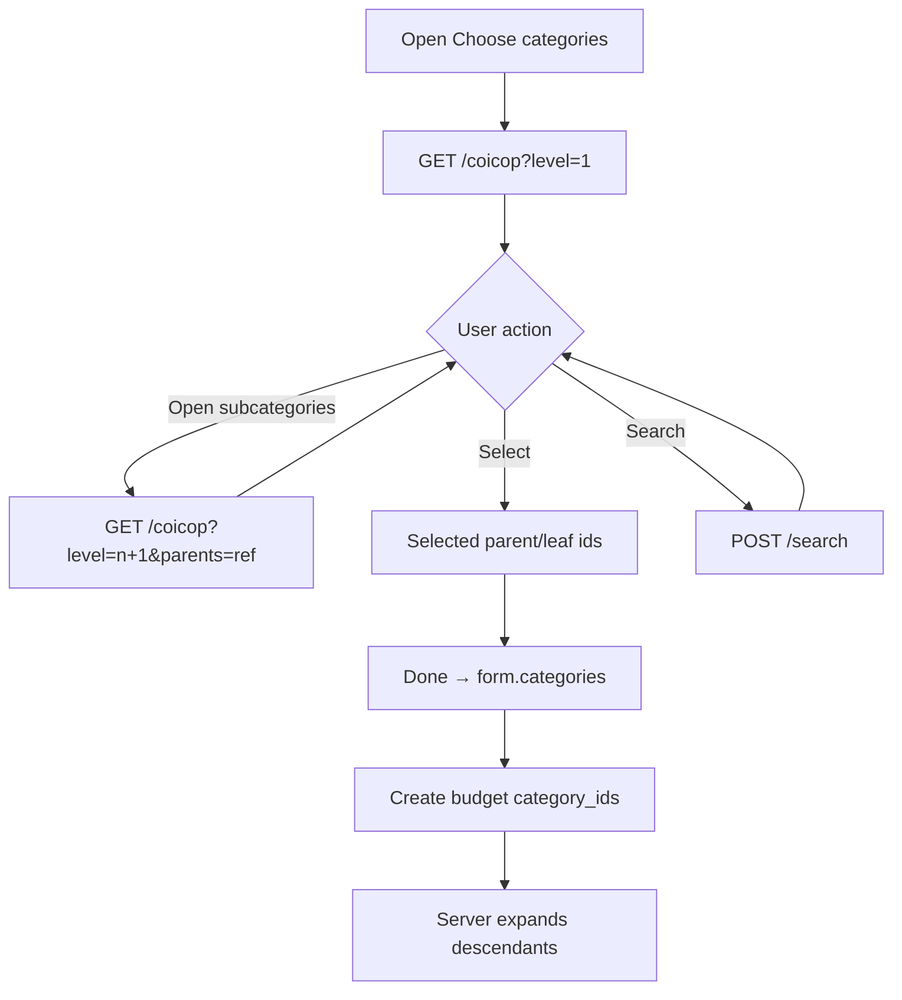

# Multi-level category selector

Status: **implemented** (Add budget wired)

## Defaults (locked for this plan)

- **First consumer:** Add budget category scope only; build as shared so expense CGL can adopt later.
- **Selection model:** Multi-select of nodes; storing a parent `id` is enough — backend expands COICOP parents to descendants for budget matching (`expand_category_ids_with_coicop_descendants`).
- **Views:** Same sheet — **Levels** (hierarchy) + **List** (flat) + **Selected** (current picks); search uses `POST /search` (ALL).
- **User-facing name:** **Multi-level categories** (not “COICOP” in UI). Code/API may still say coicop where it matches the backend path.

## Copy & naming (intuitive)

Keep jargon out of the product surface. COICOP stays an implementation detail.

| Surface | Copy |
| :--- | :--- |
| Sheet title | **Choose categories** |
| Subtitle / hint under title | **Pick a group to cover everything under it, or open it to go deeper** |
| Tabs | **Levels** \| **List** \| **Selected** |
| Levels empty (root) | **No category groups yet** / Try search |
| Levels empty (after drill) | **No subcategories here** |
| Row primary | Category title |
| Row secondary (has children) | **Open for subcategories** |
| Row secondary (leaf / selected parent) | **Covers this and all under it** when selected and has hierarchy |
| Chevron a11y | **Show subcategories** |
| Check a11y | **Select category** |
| Footer | **Done** / **Done (n)** |
| Selected chip on budget form | Title + **All under this** (when parent covers descendants) |
| Scope tile empty | **All categories** (unchanged) |
| Search placeholder | **Search categories** |

Avoid in UI: “COICOP”, “SYSTEM”, “taxonomy”, “ref”, “descendants”.

Optional tiny meta (muted): show code only as `01.1` style after title if useful for power users — never the `COICOP_` prefix.

## Why this helps

Budget “What counts → Categories” currently uses flat [`BudgetMultiSelectSheet`](src/screens/expense/add-budget/components/BudgetMultiSelectSheet.tsx) + [`GetExpenseCategoriesApi`](src/api/expense/categories.ts). Users cannot browse multi-level groups. Backend already treats a selected SYSTEM COICOP parent as covering all subcategory expenses.

## Backend (already exists — app wire-up only)

Base: `/expense/category/v1` ([`expense_category_route.py`](D:/Projects/split-smart/backend/microservices/user-services/src/routes/expense/expense_category_route.py))

| Call | Use |
| :--- | :--- |
| `GET /coicop?level=&parents=&match=any` | Exact-level browse / drill-down |
| `POST /search` | Search custom + master (materializes SYSTEM) |
| `GET /by-ref/{ref}/descendants` | Optional coverage preview later; not required for v1 |

Browse item shape: `id`, `title`, `category_ref`, `level`, `icon`, `source_type`.

## App work

### 1. API + DTOs

Extend [`src/api/dto/expense/category.ts`](src/api/dto/expense/category.ts) and [`src/api/expense/categories.ts`](src/api/expense/categories.ts):

- `ExpenseCategoryDescendantItem`, `ExpenseCategoryCoicopBrowseResponse`
- `SearchExpenseCategoryRequest/Response` (mirror backend search DTO)
- Align `ExpenseCategorySource` with backend `SYSTEM` | `CUSTOM` where needed for browse/search (keep existing list API working)
- APIs:
  - `BrowseCoicopCategoriesApi({ level, parents?, match?, offset, limit })`
  - `SearchExpenseCategoriesApi({ query, scope, offset, limit })`

### 2. Shared sheet (new)

Component name (code): [`SelectMultiLevelCategoryBottomSheet.tsx`](src/components/expense/SelectMultiLevelCategoryBottomSheet.tsx)

Helpers (if large), same folder or `src/components/expense/multi-level-category/`:

- `useMultiLevelCategoryBrowse.ts` — stack of `{ level, parentRef, title }`, fetch `/coicop`, pagination
- Selected type: `{ id, name, categoryRef?, level?, iconId?, iconUrl?, coversDescendants: boolean }`

**UX structure**

- Header: close + **Choose categories**
- One-line hint under header (see copy table)
- Breadcrumb / back uses parent **titles** (e.g. Food → …), not refs
- Tabs: **Levels** | **List** | **Selected**
- Levels list row:
  - Icon + title
  - Muted secondary: **Open for subcategories** when drill-in available
  - Check to select without navigating; chevron only to go deeper
- Footer: **Done (n)**
- Compact selected strip optional; prefer budget chips after Done
- Scroll: same flex fix as [`BudgetMultiSelectSheet`](src/screens/expense/add-budget/components/BudgetMultiSelectSheet.tsx)
- Iconify string literals; surface/color pairing

**Selection rules**

- Toggle by `id`
- Selecting a parent does **not** auto-add children to the list (server expands)
- Collapse: drop redundant children when a covering parent is selected (prefix on `category_ref`); drop parent on deselect
- Custom / non-hierarchical: `coversDescendants: false`

### 3. Wire Add Budget

In [`src/screens/expense/add-budget/index.tsx`](src/screens/expense/add-budget/index.tsx):

- Replace categories `BudgetMultiSelectSheet` with `SelectMultiLevelCategoryBottomSheet`
- Keep places/merchants/memories on `BudgetMultiSelectSheet`
- Map confirm → `setCategories` / extend `BudgetScopeEntity` with optional `categoryRef` + `coversDescendants` for chip copy only; payload still `category_ids`

Chips: show **All under this** when `coversDescendants`.

Stop using `useBudgetCategoryList` for categories only.

### 4. Out of scope (v1)

- Replacing [`SelectExpenseCategoryBottomSheet`](src/components/expense/SelectExpenseCategoryBottomSheet.tsx) on expense CGL
- New backend endpoints
- Catalog sync beyond empty-state: **No category groups yet — try search**

## Verification

- Sheet title reads **Choose categories**; no COICOP in visible copy
- Drill by titles; select parent → chip **All under this**
- Payload sends parent `id` only
- Levels + Yours + search work; list scrolls
